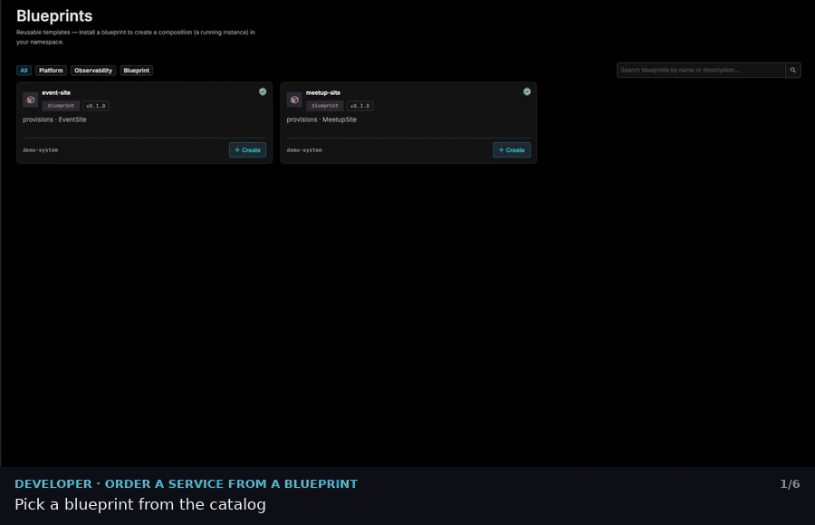
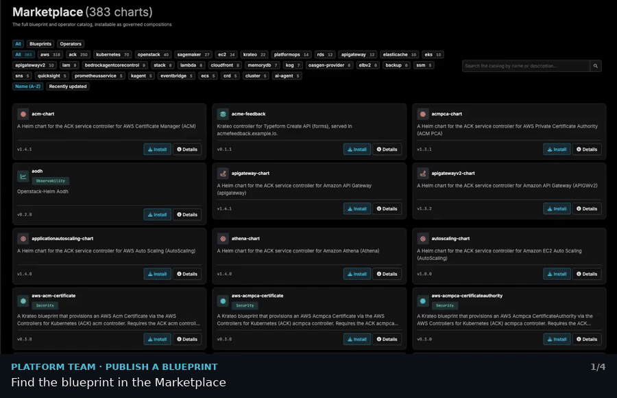
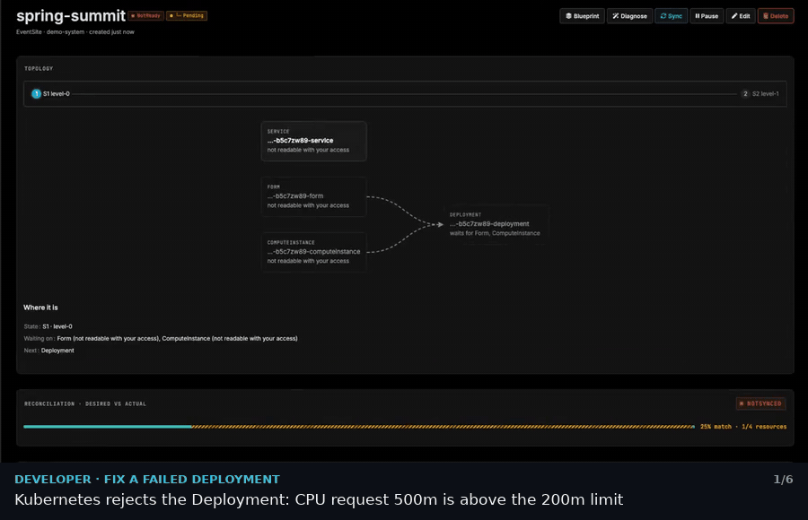
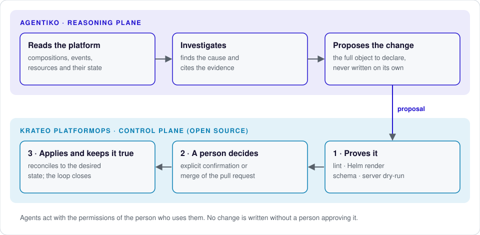

<p align="center">
  <picture>
    <source media="(prefers-color-scheme: dark)" srcset="docs/media/krateo-logo-dark-mode.png">
    
  </picture>
</p>

<p align="center">
  An open-source control plane on Kubernetes that creates and governs any resource, on any infrastructure.<br>
  Platform teams publish golden paths once; developers get a self-service portal for everything else.
</p>

<p align="center">
  
  
  
  
</p>

<p align="center">
  <a href="#install">Install</a> ·
  <a href="https://docs.krateo.io/?utm_source=github&utm_medium=readme&utm_campaign=krateo&utm_content=docs-nav">Documentation</a> ·
  <a href="#community">Community</a> ·
  <a href="#contributing">Contributing</a> ·
  <a href="#agentiko">Enterprise</a>
</p>

<p align="center">
  
  <br><em>A developer orders a service from a blueprint. <a href="#see-it-in-action">More scenarios below</a>.</em>
</p>

## What is this

Platform teams spend their time on tickets and copy-pasted templates, while every new project waits days for infrastructure that should be routine.

**Krateo PlatformOps** is a control plane that runs on Kubernetes and creates **any resource on almost any infrastructure**: Kubernetes clusters, applications, pipelines, databases, registries, API gateways.

- **One requirement.** The resource can be described in YAML as its desired state.
- **Validated, applied, reconciled.** Krateo validates every change, applies what was approved and continuously reconciles it to the desired state.
- **Inside and outside the cluster.** It manages resources beyond the cluster it runs on, on the major clouds and on-premises.
- **Clear roles.** The platform team writes the templates as **blueprints**; developers use them from a **self-service portal** and manage the whole lifecycle from one place, instead of searching across dozens of dashboards.

## Install

Krateo installs with one Helm chart, the [installer](https://github.com/krateo-platformops/installer). You need a Kubernetes cluster (1.36 or later) with no previous Krateo installation, [`kubectl`](https://kubernetes.io/docs/tasks/tools/) and [`helm`](https://helm.sh/docs/intro/install/).

```sh
helm install installer \
  oci://ghcr.io/krateo-platformops/charts/installer \
  --version 0.3.469 \
  --namespace krateo-system --create-namespace \
  --set bootstrap.coreProvider.enabled=true
```

Browser-facing services get a LoadBalancer by default. On kind or bare metal, use `--set exposure.type=NodePort`; behind a Gateway API controller, use `Gateway`. The [kind walkthrough](https://github.com/krateo-platformops/installer/blob/main/docs/runbooks/kind-default-profile.md) covers a local cluster end to end, and the [usage guide](https://github.com/krateo-platformops/installer/blob/main/docs/usage.md) covers upgrades and uninstall.

No cluster at hand? Try Krateo in the browser in the [free self-service lab](https://killercoda.com/krateoplatformops). <!-- REPLACE: verify the lab runs the Helm installer -->

## What you get

- **Golden paths as Kubernetes APIs.** Each blueprint becomes a CRD with its own schema, versioning and RBAC.
- **Any API as a resource.** Generate a Kubernetes operator from an OpenAPI spec with [oasgen-provider](https://github.com/krateo-platformops/oasgen-provider) and manage external services declaratively.
- **A composable portal.** Navigation, pages and forms are Kubernetes resources.
- **Observability built in.** OpenTelemetry collects logs, metrics, traces and Kubernetes events into ClickHouse, explorable in HyperDX. Events are tagged with the composition they belong to and stream live into the portal.

## See it in action

Recorded on the Krateo portal. Each clip is one scenario, with a caption for every step.

<details open>
<summary><b>Platform team · publish a blueprint from the Marketplace</b></summary>
<br>

</details>

<details>
<summary><b>Developer · order a service from a blueprint</b></summary>
<br>

</details>

<details>
<summary><b>Developer · fix a failed deployment</b></summary>
<br>

</details>

## Blueprints

Ready-to-use blueprints for AWS, Azure, Google Cloud, OpenStack, Keycloak and more live in the [krateo-blueprints](https://github.com/krateo-blueprints) organization.

## Docs

- [Documentation](https://docs.krateo.io/?utm_source=github&utm_medium=readme&utm_campaign=krateo&utm_content=docs) for concepts, guides and reference <!-- REPLACE: confirm the long-term docs domain -->
- [What's new in 3.0](https://docs.krateo.io/release-notes/release-note-3.0.0) and the [compatibility matrix](https://docs.krateo.io/release-notes/matrix)
- [Release notes](RELEASE_NOTES.md) for the history of every platform release

## Community

Questions and ideas go to [GitHub Discussions](https://github.com/krateo-platformops/krateo/discussions). For real-time chat, join us on [Discord](https://discord.krateo.io/). <!-- REPLACE: confirm the Discord invite domain -->

If Krateo PlatformOps is useful to you, star this repository: it helps other platform teams find it.

## Contributing

Bug reports, documentation fixes and new blueprints are the most valuable contributions right now. Read [CONTRIBUTING](https://github.com/krateo-platformops/.github/blob/main/CONTRIBUTING.md) before opening a pull request, and report vulnerabilities privately as described in the [security policy](https://github.com/krateo-platformops/krateo/security/policy).

## Develop & release

Platform releases are tag-driven and assembled by the installer; see [how a release ships](https://github.com/krateo-platformops/installer/blob/main/docs/release.md).

## License

Licensed under the [Apache License 2.0](LICENSE).

<a id="agentiko"></a>
## AGENTIKO: agents on top of Krateo PlatformOps

<picture>
  <source media="(prefers-color-scheme: dark)" srcset="docs/media/agentiko-logo-dark-mode.png">
  
</picture>

Once the platform runs, most of the work is keeping it healthy and changing it safely. AGENTIKO is the reasoning plane built by Krateo on Krateo PlatformOps: its agents read the platform, investigate, and prepare the change. They propose, they prove, a person decides, and the loop closes.

<picture>
  <source media="(prefers-color-scheme: dark)" srcset="docs/media/agentiko-architecture-dark.svg">
  
</picture>

AGENTIKO is a commercial product, in alpha at Kiratech since 3 August 2026.

[Learn about AGENTIKO](https://agentiko.eu/?utm_source=github&utm_medium=readme&utm_campaign=krateo&utm_content=agentiko-cta)
